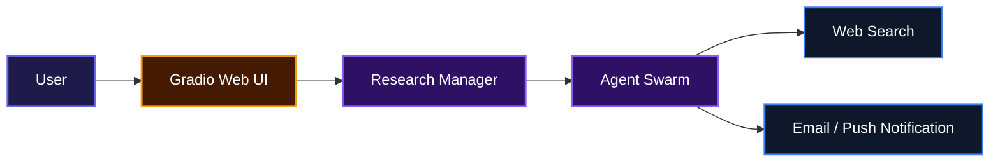
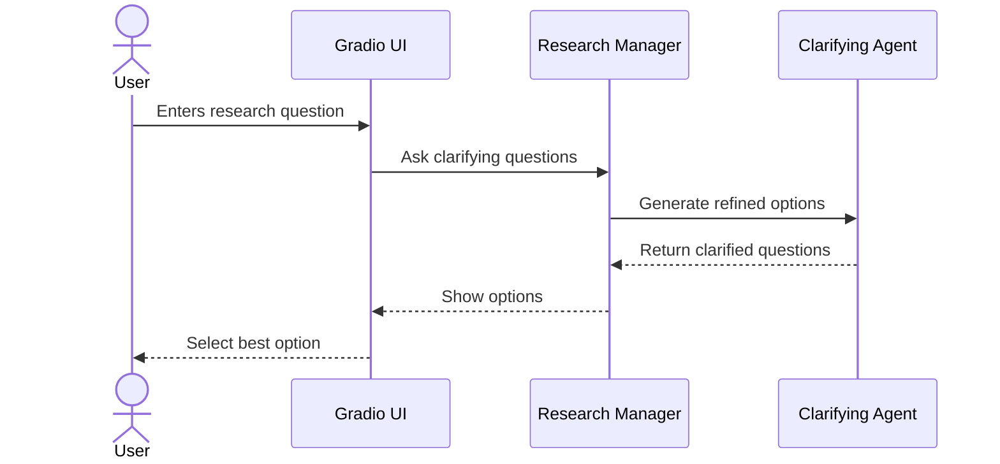
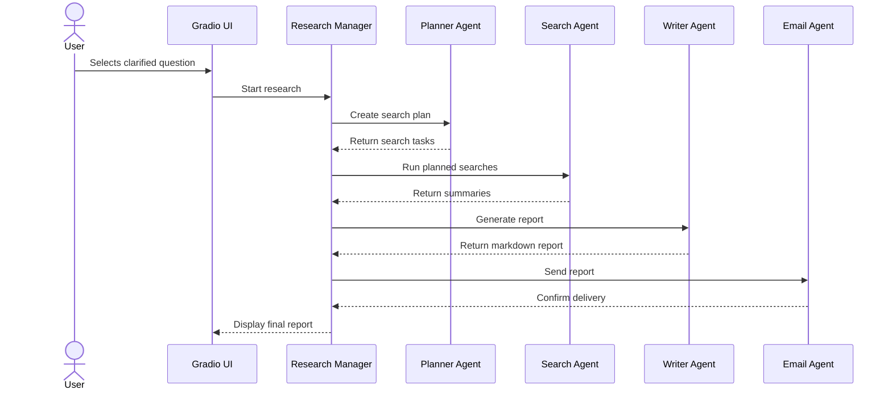

# AI Deep Research Agent

AI Deep Research Agent helps developers turn vague questions into polished research reports without spending hours searching the web. Users enter a question, choose a clarified version, and the system plans searches, gathers results, writes a detailed report, and delivers it by email. It is ideal for teams that need fast, well-organized research on any topic.

## System Architecture



## Features

- **Question Clarification**: Takes a vague question and offers a few focused alternatives so users know exactly what they will research.
- **Automated Search Planning**: Breaks a topic into targeted web searches and runs them in parallel.
- **Report Generation**: Combines search results into a long-form, markdown-formatted report with a short summary and follow-up questions.
- **Email Delivery**: Sends the finished report straight to the user's inbox.
- **Simple Web Interface**: Provides a clean Gradio UI so non-technical users can run deep research with a few clicks.

### Clarification Workflow



### Research and Delivery Workflow



## Technologies Used

| Technology | Description |
| --- | --- |
| [Python](https://www.python.org/) | Core language for the agent orchestration layer |
| [OpenAI Agents SDK](https://github.com/openai/openai-agents-python) | Multi-agent orchestration, tool calling, and web search |
| [Gradio](https://www.gradio.app/) | Interactive web UI for research input and results |
| [Pydantic](https://docs.pydantic.dev/) | Structured output models for agent responses |
| [python-dotenv](https://saurabh-kumar.com/python-dotenv/) | Environment variable management |

## Installation

### Clone the Repository

```bash
git clone https://github.com/godwintrav/ai-deep-research-agent.git
cd ai-deep-research-agent
```

### Set Up the Environment

1. Create a virtual environment:

```bash
python -m venv .venv
source .venv/bin/activate  # On Windows: .venv\Scripts\activate
```

2. Install the dependencies:

```bash
pip install -r src/requirements.txt
```

3. Create a `.env` file in the project root with your settings:

```bash
OPENAI_API_KEY="sk-..."
DEFAULT_MODEL_NAME="gpt-5.4-mini"
HOW_MANY_SEARCHES=5
NUM_OF_CLARIFYING_QUESTIONS=3

# Email delivery
EMAIL_ADDRESS="your_sender_email@example.com"
EMAIL_SMTP_SERVER="smtp.gmail.com"
EMAIL_APP_PASSWORD="your_app_password"

# Optional push notifications instead of email
USE_EMAIL="true"
PUSHOVER_USER="your_pushover_user"
PUSHOVER_TOKEN="your_pushover_token"
```

## Usage

1. Start the Gradio app:

```bash
python src/app.py
```

2. Open the local URL shown in the terminal, usually `http://localhost:7860`.
3. Enter your research question in the input box.
4. Enter the email address where you want the report sent.
5. Click **Clarify** and choose the option that best matches what you want to research.
6. The system will plan searches, gather results, write a report, and email it to you.

## API Documentation

This project does not expose a REST API. It provides a Gradio web interface and a Python API through the `ResearchManager` class in [`src/research_manager.py`](src/research_manager.py).

### `ResearchManager`

The main entry point for running research programmatically.

#### `set_recipient_email(email)`

Sets the email address where the final report will be sent.

**Request:**

```python
manager = ResearchManager()
manager.set_recipient_email("user@example.com")
```

**Response:** None

---

#### `clarify_question(initial_query)`

Generates a set of clarified question options from a vague user query.

**Request:**

```python
async for questions in manager.clarify_question("How do I start a business?"):
    print(questions)
```

**Response:**

```python
Questions(
    clarified_questions=[
        Question(
            reason="This option narrows the question to actionable steps.",
            clarified_question="What are the steps to start a successful business?"
        )
    ]
)
```

---

#### `run_research_agent(query)`

Runs the full research workflow for the selected query and streams progress updates.

**Request:**

```python
async for status in manager.run_research_agent("What are the steps to start a successful business?"):
    print(status)
```

**Response:**

```python
"## Introduction\n..."
```

## Contributing

Contributions are welcome. If you find a bug, have an idea, or want to improve the project, feel free to open an issue or pull request. For larger changes, please open an issue first so we can discuss the direction.

## Author

**Godwin Odenigbo**

- LinkedIn: [https://linkedin.com/in/godwin-odenigbo-251755174](https://linkedin.com/in/godwin-odenigbo-251755174)

## Badges

[](https://www.python.org/)
[](https://www.gradio.app/)
[](https://openai.com/)

[](https://dokugen.samueltuoyo.com)